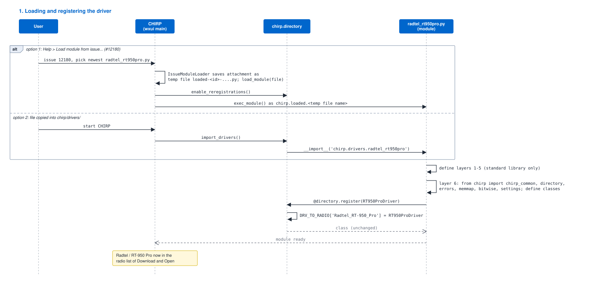
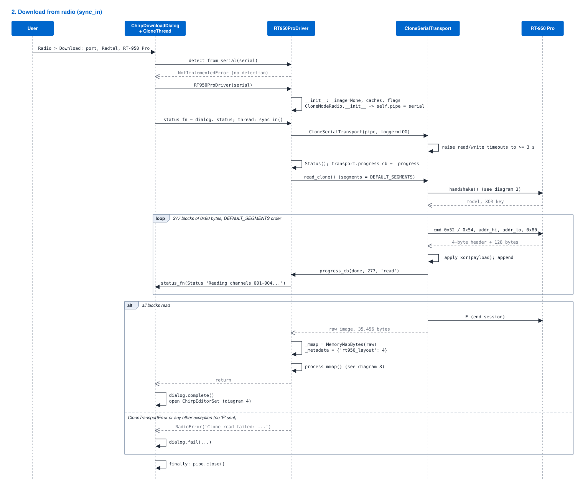
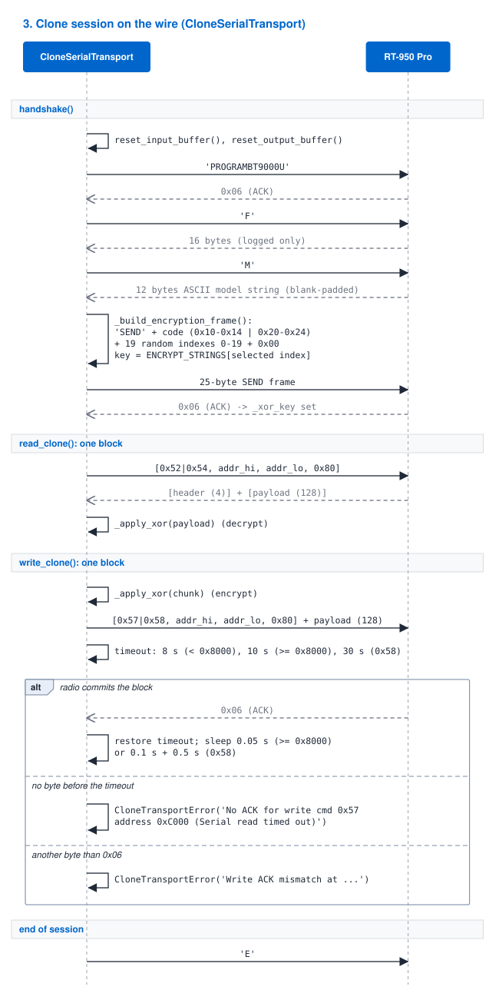
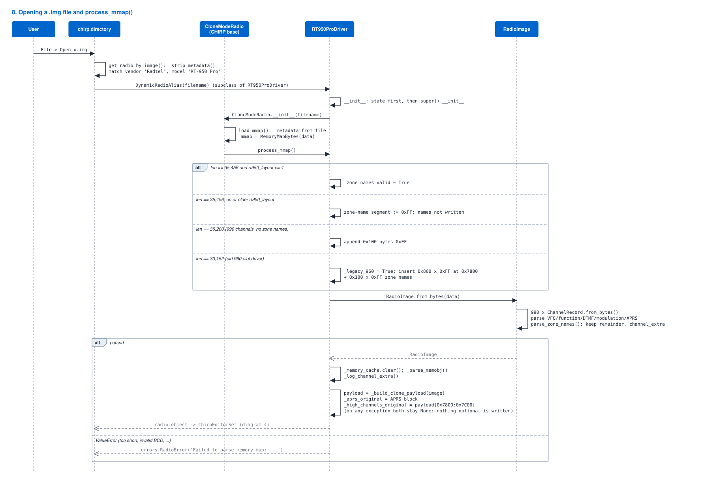
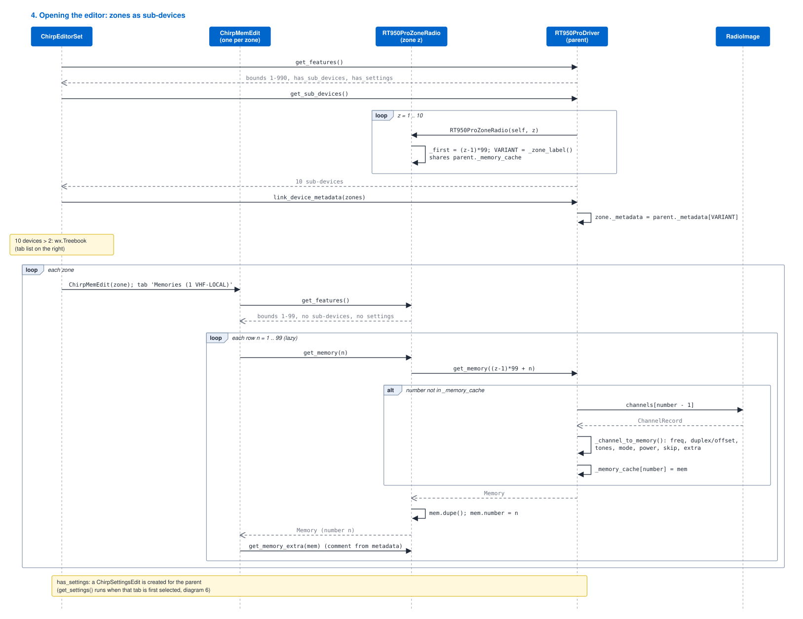
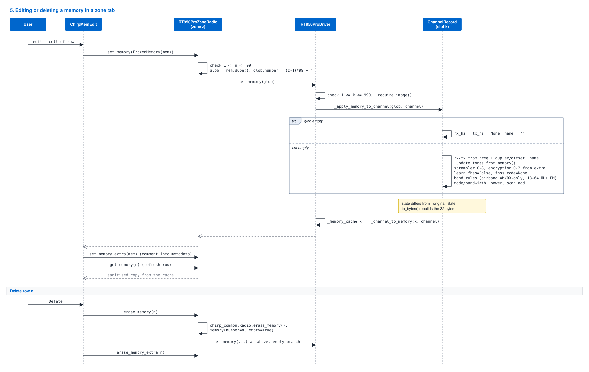
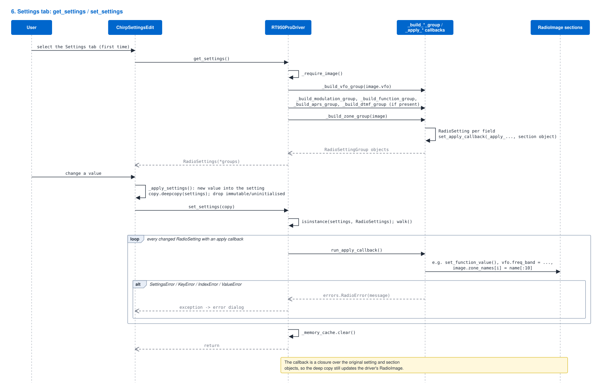
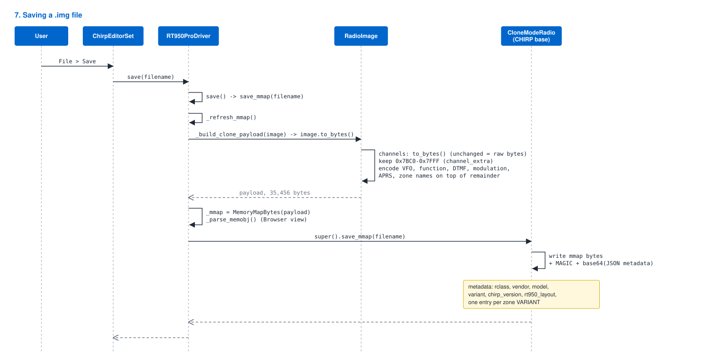
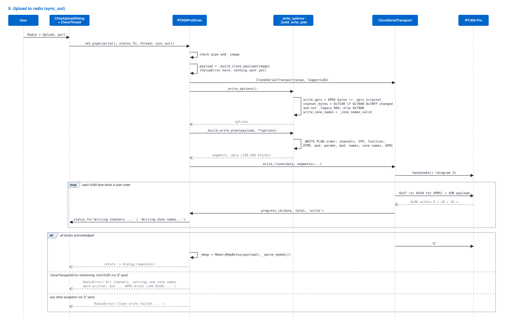

# CHIRP ↔ driver interface

This document describes how CHIRP and the RT-950 Pro driver
(`radtel_rt950pro.py`) work together: which CHIRP calls reach the driver, in
which order, what the driver does with them, and what it hands back. The
driver's internal design is described in [`fto.md`](fto.md); the byte layout
in [`memory-map.md`](memory-map.md) and the wire protocol in
[`protocol.md`](protocol.md).

| | |
|---|---|
| Driver | `radtel_rt950pro.py`, version 0.1.7 (2026-10-24) |
| CHIRP reference | `kk7ds/chirp` at commit `0a9be8e` (2026-10-17), wxPython UI (`chirp/wxui`); the rebuild of the editor after a volatile setting (§7.4) checked at commit `c604141` (2026-10-23) |
| Radio | Radtel RT-950 Pro, firmware 0.29 (10 zones × 99 channels) |

The CHIRP behaviour described here was read from the CHIRP source at the
commit above (`chirp/chirp_common.py`, `chirp/directory.py`,
`chirp/settings.py`, `chirp/wxui/main.py`, `clone.py`, `memedit.py`,
`settingsedit.py`). Other CHIRP versions may differ in detail.

---

## 1. Overview

CHIRP treats the RT-950 Pro as a **clone-mode radio**: the whole memory is
downloaded into an image, edited offline, and uploaded again. The driver
plugs into CHIRP through one registered class and, in Zone CH Mode, ten
sub-devices (in All CH Mode CHIRP uses the registered class itself as the
only memory list; see §7.4):

| Object | Role towards CHIRP |
|---|---|
| `RT950ProDriver` | The class registered with `@directory.register`. CHIRP instantiates it for *Download*, for *Open* of an `.img` file, and keeps it as the radio behind the editor. It adds nothing to `RT950ProRadio`. |
| `RT950ProRadio` | Shared base class with all behaviour: clone (`sync_in`/`sync_out`), image handling (`process_mmap`, `get_mmap`, `save_mmap`), memories 1–990, settings, sub-devices. Subclass of `chirp_common.CloneModeRadio`. |
| `RT950ProZoneRadio` | One object per zone (10), only in Zone CH Mode. CHIRP shows each as a memory tab with memories 1–99. It owns no data: every call is mapped to the parent's memory `(zone − 1) × 99 + n`. |

All channel and settings data lives in one `RadioImage` object owned by the
parent (`RT950ProRadio._image`). CHIRP's own memory map (`_mmap`) is rebuilt
from that object when the image is saved; an upload builds its own payload
from it.

### 1.1 Entry points

| CHIRP action | CHIRP calls | Driver method(s) | Diagram |
|---|---|---|---|
| Start CHIRP / *Load module from issue* | `import_drivers()` / `load_module()` | module import, `@directory.register` | [1](#3-loading-the-driver) |
| *Radio → Download from radio* | `RT950ProDriver(serial)`, `sync_in()` | `__init__`, `sync_in`, `process_mmap` | [2](#4-download-from-the-radio), [3](#5-clone-session-on-the-wire) |
| *File → Open* `.img` | `get_radio_by_image()` → `DynamicRadioAlias(filename)` | `__init__`, `process_mmap` | [8](#6-opening-an-img-file-process_mmap) |
| Editor opens | `get_features()`, `get_sub_devices()`, `link_device_metadata()` | `get_features`, `get_sub_devices` | [4](#7-the-editor-zones-as-sub-devices) |
| Show a row | `get_memory(n)` on the zone | `RT950ProZoneRadio.get_memory` → `RT950ProRadio.get_memory` | [4](#7-the-editor-zones-as-sub-devices) |
| Edit / delete a row | `set_memory(FrozenMemory)` / `erase_memory(n)` on the zone | `RT950ProZoneRadio.set_memory` → `RT950ProRadio.set_memory` | [5](#9-editing-and-deleting-a-memory) |
| *Settings* tab | `get_settings()`, `set_settings(copy)` | `get_settings`, `set_settings` + apply callbacks | [6](#10-settings) |
| *File → Save* | `save(filename)` | `save_mmap` | [7](#11-saving-an-img-file) |
| *Radio → Upload to radio* | `set_pipe(serial)`, `sync_out()` | `sync_out`, `_write_options`, `_build_write_plan` | [9](#12-upload-to-the-radio) |
| Developer *Browser* tab | reads `radio._memobj` | `_parse_memobj` (`MEM_FORMAT`), run in `process_mmap`, `save_mmap`, `sync_out` | – |

---

## 2. What the driver declares

### 2.1 Class attributes

| Attribute | Value | Used by CHIRP for |
|---|---|---|
| `VENDOR` | `"Radtel"` | radio list, image metadata, driver id |
| `MODEL` | `"RT-950 Pro"` | radio list, image metadata, driver id |
| `BAUD_RATE` | `115200` | opening the serial port |
| `_memsize` | `35,456` (`_SEGMENT_LENGTH`) | `get_memsize()`, radio-info dialog only |

The directory id built by CHIRP (`radio_class_id`) is `Radtel_RT-950_Pro`.

### 2.2 `get_features()`

| Feature | Parent (`RT950ProRadio`) | Zone (`RT950ProZoneRadio`) |
|---|---|---|
| `memory_bounds` | `(1, 990)` | `(1, 99)` |
| `has_sub_devices` | `True` in Zone CH Mode, `False` in All CH Mode (§7.4) | `False` |
| `has_dynamic_subdevices` | `True` (left out on CHIRP versions without it) | `False` |
| `has_settings` | `True` | `False` |
| `has_bank`, `has_bank_names` | `False` | `False` |
| `has_name`, `valid_name_length` | `True`, 12 | same |
| `valid_characters` | `chirp_common.CHARSET_ASCII` | same |
| `valid_modes` | `FM`, `NFM`, `AM` | same |
| `valid_tmodes` | `""`, `Tone`, `TSQL`, `DTCS`, `Cross` | same |
| `has_cross`, `valid_cross_modes` | `True`, `chirp_common.CROSS_MODES` | same |
| `valid_duplexes` | `""`, `+`, `-`, `split` (`can_odd_split`) | same |
| `valid_dtcs_pols` | `NN`, `NR`, `RN`, `RR` | same |
| `valid_dtcs_codes` | `chirp_common.DTCS_CODES` | same |
| `valid_power_levels` | Low 1 W, Medium 5 W, High 10 W (nominal) | same |
| `valid_skips` | `""`, `S` | same |
| `valid_bands` | 18–64, 70–118, 118–137, 136–174, 174–400, 400–480, 480–580 MHz | same |
| `has_comment` | not set (CHIRP default `False`) | same |

Because `has_comment` is `False`, CHIRP keeps memory comments itself, in the
image metadata (`mem_extra`), not in the radio (see §7.3).

---

## 3. Loading the driver



There are two ways in, as described in the README:

1. **Load module from issue** (#12180). CHIRP saves the chosen attachment
   to a temporary file (`loaded-<attachment id>-….py`) and calls
   `load_module()`. That first calls `directory.enable_reregistrations()`, so
   the module may replace a driver with the same id, then executes the file
   as `chirp.loaded.<temporary file name>`. The module is gone when CHIRP
   exits.
2. **Copy into `chirp/drivers/`.** At start-up `directory.import_drivers()`
   imports every `*.py` in that directory. The Windows installer build does
   not scan the directory (it imports the names in `chirp.drivers.__all__`),
   so this route does not work there.

Executing the module:

* defines layers 1–5 (standard library only);
* at the start of layer 6 imports `chirp_common`, `directory`, `errors`,
  `memmap`, `bitwise` and `chirp.settings`. If that import fails (no CHIRP,
  e.g. pydoc), the module defines small stand-ins so it still imports (§14);
* defines the rest of layer 6;
* registers `RT950ProDriver` with `@directory.register`. `RT950ProRadio`
  itself is not registered;
* sets `DRIVER_CLASS = RT950ProDriver` for loaders that look for that name.

---

## 4. Download from the radio



1. CHIRP's download dialog opens the port and first calls
   `detect_from_serial()`. The driver does not implement detection, so the
   default raises `NotImplementedError` and CHIRP keeps the chosen class.
2. CHIRP creates `RT950ProDriver(serial)`. The driver's `__init__` sets its
   own state **before** calling CHIRP's constructor, because CHIRP's
   constructor may call `process_mmap()` (it does so for a file name or a
   `MemoryMapBytes`; for a serial port it resets `errors`, `_mmap`,
   `_memobj`, `_metadata` and stores `self.pipe`).
3. CHIRP's `CloneThread` sets `radio.status_fn` and runs `sync_in()` in a
   background thread.
4. `sync_in()` wraps the port in a `CloneSerialTransport` (read and write
   time-outs raised to at least 3 s), attaches a progress callback and calls
   `read_clone()`. The transport reads all `DEFAULT_SEGMENTS`: 277 blocks of
   0x80 bytes, 35,456 bytes in total.
5. After every block the progress callback converts the block count into a
   `chirp_common.Status` and calls `status_fn`. Messages are
   `Reading channels 001-004…` for the channel segment (4 channels per block)
   and `Reading VFO settings…`, `Reading Zone names…` etc. for the others.
6. On success the driver stores the bytes as `MemoryMapBytes`, **replaces**
   `_metadata` with `{'rt950_layout': 4}` and calls `process_mmap()` (§6).
7. Any exception in the read is re-raised as
   `errors.RadioError('Clone read failed: …')`, which CHIRP shows in the
   dialog. CHIRP closes the port in all cases.

Read order (= image order, `DEFAULT_SEGMENTS`):

| # | Command | Address | Length | Blocks | Content |
|---|---|---|---|---|---|
| 0 | `0x52` | `0x0000` | `0x8000` | 256 | channels 1–990 + `0x7BC0–0x7FFF` |
| 1 | `0x52` | `0x8000` | `0x100` | 2 | VFO A/B/C |
| 2 | `0x52` | `0x9000` | `0x100` | 2 | function settings |
| 3 | `0x52` | `0xA000` | `0x200` | 4 | DTMF |
| 4 | `0x52` | `0xB000` | `0x200` | 4 | modulation parameters |
| 5 | `0x52` | `0xD000` | `0x300` | 6 | modulation names |
| 6 | `0x54` | APRS `0x0000` | `0x80` | 1 | APRS (separate address space) |
| 7 | `0x52` | `0xC000` | `0x100` | 2 | zone names |

---

## 5. Clone session on the wire



`CloneSerialTransport` implements the session for both directions:

* **Handshake**: `PROGRAMBT9000U` → `0x06`; `F` → 16 bytes (only logged);
  `M` → 12-byte model string (an empty string is an error); a 25-byte
  `SEND` frame that selects one of 20 four-byte XOR keys
  (`ENCRYPT_STRINGS`) → `0x06`.
* **Read block**: `cmd, addr_hi, addr_lo, 0x80` → 4-byte header + 128 bytes;
  the payload is XOR-decoded.
* **Write block**: header + XOR-encoded 128 bytes → `0x06`. The ACK time-out
  is 8 s below `0x8000`, 10 s from `0x8000`, 30 s for command `0x58`; after
  the ACK the driver pauses 0.05 s (from `0x8000`) or 0.1 s + 0.5 s (APRS).
* **End**: `E`. It is sent only after the last block; when a block fails, the
  exception leaves the loop before `E` is sent.

XOR rule: a payload byte is left unchanged when it is `0x00` or `0xFF`, equal
to the key byte or its complement, or when the key byte is a space (`0x20`).
The operation is its own inverse.

---

## 6. Opening an `.img` file (`process_mmap`)



`directory.get_radio_by_image()` strips CHIRP's metadata block from the file
and matches `vendor` / `model` against the registered classes. For a match it
creates a `DynamicRadioAlias` — a subclass of `RT950ProDriver` with the
vendor, model and variant from the file — with the file name. CHIRP's
constructor calls `load_mmap()`, which sets `_metadata` from the file and
`_mmap` to the image bytes, and then calls the driver's `process_mmap()`.

`process_mmap()` recognises three image sizes (four cases), so that images
from earlier driver versions still open safely:

| Image size (bytes) | Origin | Action | Effect on upload |
|---|---|---|---|
| 35,456 with `rt950_layout ≥ 4` | downloaded with this driver (layout version 4) | none; `_zone_names_valid = True` | zone names written |
| 35,456 without / older `rt950_layout` | earlier driver version, from before zone names were read at `0xC000` | zone-name segment replaced by `0xFF`; warning logged | zone names **not** written |
| 35,200 (`_MEMSIZE_V1`) | 990 channels, no zone-name segment | `0xFF` × 0x100 appended | zone names not written |
| 33,152 (`_LEGACY_MEMSIZE`) | old 960-slot driver | `0xFF` × 0x800 inserted at `0x7800`, zone segment appended; `_legacy_960 = True` | `0x7800–0x7BFF` never written |

When the bytes are adapted, CHIRP's `_mmap` is replaced by the adapted
version, so a later save writes the new size.

Then:

1. `RadioImage.from_bytes()` parses the 990 channel records and every
   section that fits in the data. A `ValueError` (image too short, invalid
   BCD digit, …) becomes `errors.RadioError('Failed to parse memory map: …')`.
2. The memory cache is cleared, the developer Browser view is rebuilt
   (`bitwise.parse(MEM_FORMAT, _mmap)`, never fatal) and printable text in
   `0x7BC0–0x7FFF` is logged (diagnostic only).
3. Two **snapshots** are taken from a freshly built payload: the APRS block
   (`_aprs_original`) and bytes `0x7800–0x7BFF` (`_high_channels_original`).
   They decide later whether these parts are uploaded (§12). If building the
   payload fails, both stay `None`, which disables both writes.

The same `process_mmap()` runs after a download (§4), always with the
current layout version.

---

## 7. The editor: zones as sub-devices



### 7.1 Tabs

`ChirpEditorSet` asks the parent for its features. In Zone CH Mode
`has_sub_devices` is set, so it calls `get_sub_devices()` and gets ten new
`RT950ProZoneRadio` objects (All CH Mode: §7.4). Each one:

* stores the parent, its zone number and `_first = (zone − 1) × 99`;
* sets `VARIANT` from the zone name: `"1 VHF-LOCAL"` for a named zone,
  `"Zone 1"` for an empty name. CHIRP uses it in the tab title
  `Memories (1 VHF-LOCAL)`;
* shares the parent's `_memory_cache` and reads the parent's image through
  the `_image` property (assignments to `_image` on a zone are ignored);
* deliberately does **not** call CHIRP's constructor: it has no port, file
  or memory map of its own. It sets the attributes CHIRP expects
  (`pipe`, `_mmap`, `_memobj`, `_metadata`, `errors`) itself.

CHIRP then calls `link_device_metadata(zones)`, which points each zone's
`_metadata` at `parent._metadata[VARIANT]`, so per-zone data ends up in the
parent's image metadata when saving. With more than two devices, or with
`has_dynamic_subdevices` set (always, since 0.1.7), CHIRP uses a
`wx.Treebook`, which puts the tab list on the right (the optional
`tools/chirp_list_left.py` patch moves it).

As `has_settings` is set on the parent, CHIRP also creates a settings editor
for the parent radio (§10).

### 7.2 Memory numbering

| View | Numbers | Mapping |
|---|---|---|
| Zone tab *z* (Zone CH Mode) | 1–99 | parent memory `(z − 1) × 99 + n` |
| Single list (All CH Mode) | 1–990 | the parent itself: memory *n* is radio channel *n* |
| Parent (driver API, tests) | 1–990 | slot `number − 1` in `RadioImage.channels` |
| Radio address | – | `(number − 1) × 32` |

`RT950ProZoneRadio.get_memory(n)` asks the parent for memory
`_first + n`, takes a `dupe()` and renumbers it to `n`. The parent builds the
`Memory` with `_channel_to_memory()` on first use and caches it by its
1–990 number until the memory, the settings or the image change.

### 7.3 Memory comments

The driver does not store comments. CHIRP's `ExternalMemoryProperties`
(`get_memory_extra` / `set_memory_extra`) keeps them in the zone's
`_metadata['mem_extra']`, which is linked to `parent._metadata[VARIANT]`
and saved in the `.img` metadata. They are never sent to the radio. In All
CH Mode CHIRP keeps them in the parent's own `_metadata['mem_extra']`,
by memory number 1–990 (see §15, item 6).

### 7.4 Channel Divide: zone tabs or one list

The radio setting *Channel Divide* (function byte `0x9026`: `0` Zone CH
Mode, `1` All CH Mode, measured with the CPS) decides the view. The driver
reads it from the image in `_all_channels_mode()`; only `1` counts as All
CH Mode, so `0xFF` (not set) or an unknown value gives the zone view.

| | Zone CH Mode | All CH Mode |
|---|---|---|
| `get_features().has_sub_devices` | `True` | `False` |
| `get_sub_devices()` | ten `RT950ProZoneRadio` | `[]` |
| What CHIRP shows | ten zone tabs, memories 1–99 | one list *Memories*: the parent, memories 1–990 |
| Empty channels | empty rows in their zone | empty rows at their place in 1–990; nothing is moved up |

The channel records are the same in both modes; only the numbering in the
view differs (§7.2).

In the settings the setting is a list *Channel Divide* (Function Settings)
with the CPS choices *Zone CH Mode* and *All CH Mode*. It is marked
**volatile** (`RadioSetting.set_volatile(True)`), and `get_features()` sets
`has_dynamic_subdevices`. When the user changes it, CHIRP
(`settingsedit.py`, `common.py`):

1. shows *"Changing this setting requires refreshing the settings from the
   image, which will happen now."*;
2. calls `set_settings()`, which stores the new value in the image (one
   byte) — synchronously for a clone-mode radio;
3. because `has_dynamic_subdevices` is set, posts an `EditorRefresh` event;
   `_reload_editorset()` in `main.py` builds a new `ChirpEditorSet` for the
   same radio object and file name, keeps the *modified* flag, and replaces
   the old one. The new editor set calls `get_features()` and
   `get_sub_devices()` again, so it shows the other view.

Nothing is saved or reread from disk; unsaved edits stay in the image. On a
CHIRP version without `has_dynamic_subdevices` the driver leaves the flag
out; CHIRP then only refreshes the settings tab, and the new view appears
after the image is saved and reopened.

---

## 8. Memory ↔ channel record mapping

### 8.1 Radio → CHIRP (`_channel_to_memory`)

| CHIRP `Memory` field | Source in `ChannelRecord` |
|---|---|
| `empty` | `True` when `rx_hz` is `None` (RX frequency bytes all `0x00`/`0xFF`); nothing else is filled |
| `freq` | `rx_hz` |
| `duplex`, `offset` | TX missing or equal to RX → `""`, 0; RX and TX in different bands of `VALID_BANDS` (`chirp_common.is_split`) → `split`, TX frequency; otherwise TX above RX → `+`, difference; TX below RX → `-`, difference |
| `name` | `name`, stripped |
| `tmode`, `rtone`, `ctone`, `dtcs`, `rx_dtcs`, `dtcs_polarity` | see §8.3 |
| `mode` | `AM` if `rx_modulation` is AM, else `NFM` (narrow) or `FM` (wide) |
| `power` | `PowerLevel` → Low / Medium / High |
| `skip` | `""` if `scan_add`, else `S` |
| `extra` | group *RT-950 Pro Extras*: `scrambler` (0–8), `encryption` (0–3) |

Not shown in CHIRP but kept: signalling group, PTT ID, busy lockout,
TX-enable flag, and learn-FHSS and FHSS code until the memory is edited
(they are then cleared, §8.2). An unedited record is written back byte for
byte (§9).

### 8.2 CHIRP → radio (`_apply_memory_to_channel`)

| `ChannelRecord` field | From `Memory` |
|---|---|
| `rx_hz`, `tx_hz`, `name` | empty memory: `None`, `None`, `""` (other fields unchanged) |
| `rx_hz` | `freq` |
| `tx_hz` | `+`: freq + offset; `-`: freq − offset; `split`: offset; else freq |
| `name` | `name`, stripped (encoded later as GB2312, max. 12 bytes) |
| `tx_tone`, `rx_tone` | see §8.3 |
| `scrambler` | `extra['scrambler']`, 0–8, otherwise 0 |
| `encryption` | `extra['encryption']`, 0–3, otherwise 0 |
| `learn_fhss`, `fhss_code` | always cleared |
| `rx_modulation`, `bandwidth` | 118–137 MHz: AM, wide, `tx_enabled = False`; 18–64 MHz: FM, narrow for `NFM`; otherwise AM/wide for `AM`, FM narrow/wide for `NFM`/`FM` |
| `power` | CHIRP label Low/Medium/High; unknown label leaves it unchanged |
| `scan_add` | `skip != "S"` |

`tx_enabled` is only ever cleared (airband), never set back to `True`.

### 8.3 Tones

Both directions use CHIRP's own helpers, so every CHIRP tone mode
including `Cross` is supported (`has_cross = True`, `valid_cross_modes` =
`chirp_common.CROSS_MODES`).

Radio → CHIRP (`_apply_tones`): each radio tone becomes a CHIRP tone spec
(`_tone_to_chirp`) and `chirp_common.split_tone_decode` picks the mode:

| TX tone | RX tone | CHIRP result |
|---|---|---|
| off | off | `tmode = ""` |
| CTCSS | off | `Tone`, `rtone` = TX |
| CTCSS | same CTCSS | `TSQL`, `ctone` = TX tone |
| DCS | same DCS code | `DTCS`, `dtcs` = the code (`rx_dtcs` stays 023), polarity TX + RX |
| any other combination | | `Cross` with the matching `cross_mode`, e.g. `->Tone` (RX tone only), `DTCS->` (TX DCS only), `Tone->Tone` (two different CTCSS tones), `DTCS->Tone`, `Tone->DTCS`, `DTCS->DTCS` (two different codes) |

The radio's inverted DCS polarity `I` is given to CHIRP as reverse `R`;
normal stays `N`. `dtcs` and `rx_dtcs` are set to a valid code (023) and
the polarity to `NN` first, because CHIRP's CSV export checks them even
when `tmode` is not `DTCS`.

CHIRP → radio (`_update_tones_from_memory`): `chirp_common.split_tone_encode`
gives a TX and an RX tone spec for every mode, including `Cross`; each spec
becomes a radio tone (`_tone_from_chirp`). CHIRP's `R` is stored as the
radio's `I`. A DCS code of 0 is stored as no tone. The CHIRP memory is not
modified.

In CHIRP's memory grid, choosing `Cross` as Tone Mode opens a dialog that
asks for the cross mode; in the memory's *Properties* dialog all tone
fields can be set at once.

---

## 9. Editing and deleting a memory



* CHIRP's memory editor wraps the edited memory in
  `FrozenMemory(mem, strict=False)` and calls `set_memory()` on the zone.
  The zone checks the number (1–99), takes a `dupe()`, renumbers it to
  `(zone − 1) × 99 + n` and passes the copy to the parent, so CHIRP's frozen
  object is never modified on this path.
* The parent checks the number (1–990), updates the `ChannelRecord` in place
  (§8.2), converts the record back to a `Memory` and caches that sanitised
  version. CHIRP's refresh (`get_memory`) shows it, so the user sees what
  will actually be written (e.g. AM forced in the airband).
* The record now differs from its `_original_state`; at the next
  `to_bytes()` it is rebuilt from its fields instead of returning the
  original 32 bytes.
* Deleting uses CHIRP's default `Radio.erase_memory()`: it builds
  `Memory(number=n, empty=True)` and calls the zone's `set_memory()`. The
  driver then clears RX, TX and name only; the RX frequency `0xFF × 4` marks
  the slot empty on the radio.

No serial traffic happens while editing; everything changes the in-memory
`RadioImage` only.

---

## 10. Settings



CHIRP calls `get_settings()` the first time the *Settings* tab is selected.
The driver builds a `RadioSettings` tree from the image; a group is left out
when its section is missing from the image (VFO also when the list is empty),
except Zone Names, which is always present:

| Group | Builder | Content |
|---|---|---|
| VFO Profiles | `_build_vfo_group` | per VFO (VFO-A to VFO-C) the fields of the CPS *VFO Mode* screen, with its labels, choices and order: Rx Freq, Rx QT/DQT, Tx QT/DQT, Busy Lockout, Offset Dir, Signalling, Tx Power, Scramble, Bandwidth, Encryption, RxModulation, Freq Band (read-only), Step Freq, Offset Freq |
| Broadcast/Modulation | `_build_modulation_group` | current FM/AM/SSB channel, work mode, modulation mode, AM/SSB step and RX gain; FM, AM and SSB memories (frequency, name; SSB also bandwidth and beat offset) |
| Function Settings | `_build_function_group` | the 27 keys of `_FUNCTION_UI` (squelch, VOX, time-out, beeps, display modes, …, Channel Divide) |
| APRS Settings | `_build_aprs_group` | the 11 keys of `_APRS_UI` (enable, GPS, callsign, SSID, priority, custom message, …) |
| DTMF Settings | `_build_dtmf_group` | own ID, PTT ID mode, code groups 1–5 (of 22) |
| Zone Names | `_build_zone_group` | ten strings, max. 12 ASCII characters |

Every `RadioSetting` gets an **apply callback** bound to the object it
changes (a `VFOSettings` entry, the `FunctionSettings`, `APRSSettings`,
`DTMFSettings`, `ModulationSettings`, or the `RadioImage` for zone names).

When the user changes a value, CHIRP puts the new value into its settings
tree, makes a `copy.deepcopy()` of the tree, removes immutable and
uninitialised settings, and calls `set_settings(copy)`. The driver walks the
tree and runs the apply callback only of settings whose `changed()` is
`True`; CHIRP marks a setting as changed once its value has been set in this
editor session, and the mark stays until CHIRP rebuilds the settings tab
with `get_settings()` (for example when the image is reopened). A setting
object without `changed()` always has its callback run. The callbacks still
update the driver's own objects: CHIRP stores the callback
as a closure (`lambda: callback(self, *args)`), and `deepcopy` keeps
functions by reference, so the closure still refers to the original setting
and section objects. The callbacks validate through the settings API
(`set_function_value`, `set_aprs_value`, `set_dtmf_*`). Error wrapping
differs per group:

| Callbacks | Wrapped into `errors.RadioError` |
|---|---|
| `_apply_function_setting`, `_apply_aprs_setting` | `SettingsError`, `KeyError`, `IndexError`, `ValueError` |
| `_apply_dtmf_id`, `_apply_dtmf_mode` | `SettingsError` |
| `_apply_dtmf_group` | `SettingsError`, `IndexError` |
| `_apply_vfo_frequency`, `_apply_vfo_offset` | `ValueError` |
| `_apply_modulation_channel_frequency` | none: an invalid frequency raises a plain `ValueError` |

CHIRP shows any exception from `set_settings()` as an error dialog. Because
the callbacks run in tree order, an exception also stops the callbacks after
it. If all succeed, the memory cache is cleared.

Because only changed settings are applied, opening the *Settings* tab and
applying an edit of one setting leaves all other settings as they were read.
The list callbacks (VFO, modulation) also store a value only when the chosen
label is one of the offered choices, so a stored value shown as
`Unknown (<value>)` is kept. Two VFO values are not shown as unknown: a
power nibble above 2 is read as Low, and a tone with a DCS index the driver
does not know is shown as OFF.

A renamed zone gets its new tab title only when the sub-devices are created
again, i.e. after the image is reopened (or after Channel Divide is changed,
which rebuilds the editor; §7.4).

---

## 11. Saving an `.img` file



CHIRP's `save()` calls `save_mmap()`. The driver first rebuilds CHIRP's memory
map from the `RadioImage` (`_refresh_mmap` → `_build_clone_payload` →
`RadioImage.to_bytes()`), then lets CHIRP's `CloneModeRadio.save_mmap()`
write the file:

```
[35,456 image bytes] [MAGIC b'\x00\xffchirp\xeeimg\x00\x01'] [base64(JSON metadata)]
```

The metadata contains CHIRP's own keys (`rclass`, `vendor`, `model`,
`variant`, `chirp_version`), the driver's `rt950_layout` (when the image
came from a download, or from a file that already had it) and one entry per
zone `VARIANT` with that zone's `mem_extra` comments.

`to_bytes()` writes unedited channel records and VFO entries back
byte-identical and keeps `0x7BC0–0x7FFF` and unknown bytes. The modulation
and APRS encoders compare each field with the bytes that were read and write
only the fields that were edited, so an unedited image is saved
byte-identical. An edited channel record keeps the high nibbles of bytes 12
and 13, which the driver does not use.

---

## 12. Upload to the radio



CHIRP's upload dialog opens the port, calls `set_pipe(serial)` on the radio
that is open in the editor and runs `sync_out()` in a `CloneThread`.

1. `sync_out()` refuses to start without a port or an image
   (`RadioError`).
2. It builds the complete payload. A record that cannot be encoded
   raises `ValueError` here, **before** anything is sent.
3. `_write_options()` decides the optional parts:

   | Option | Rule |
   |---|---|
   | `channel_bytes` | `0x7C00` (channels 1–990) only when bytes `0x7800–0x7BFF` differ from the snapshot taken in `process_mmap()` and the image is not a legacy 960-slot image; otherwise `0x7800` (channels 1–960) |
   | `write_zone_names` | `_zone_names_valid` (zone names were read from `0xC000`) |
   | `write_aprs` | the APRS block differs from its snapshot |

4. `_build_write_plan()` cuts the payload into segments in `_WRITE_PLAN`
   order: channels, VFO, function, DTMF, modulation parameters, modulation
   names, zone names, APRS last. Of the function segment only
   `0x9000–0x907F` is written (one block); `0x9080–0x90FF` is left to the
   radio, see [`memory-map.md`](memory-map.md). That is 257 blocks minimum
   (no zone names, no APRS), 259 typically, 268 maximum.

   

5. `write_clone()` performs the handshake and writes block by block; the
   progress callback reports `Writing channels …` / `Writing Zone names…`.
6. Errors:
   * a missing ACK on the APRS block (message contains `cmd 0x58`) →
     `RadioError('All channels, settings and zone names were written, but the
     radio did not acknowledge the APRS block (cmd 0x58); APRS changes may NOT
     be saved. Power-cycle the radio and read back.')`;
   * any other failure → `RadioError('Clone write failed: …')`, e.g.
     `No ACK for write cmd 0x57 address 0xC000 (Serial read timed out)`.
     This includes a wrong ACK byte on the APRS block
     (`Write ACK mismatch at 0x0000: …`), which does not contain `cmd 0x58`.
7. On success CHIRP's memory map is replaced by the payload that was built
   in step 2.

Never written: `0x7C00–0x7FFF`, `0x9080–0x90FF` and anything from `0xE000`.

---

## 13. Errors and logging

| Situation | Raised in driver | What CHIRP shows |
|---|---|---|
| Serial time-out, missing or wrong ACK, short write | `CloneTransportError` | wrapped: `Clone read failed: …` / `Clone write failed: …` |
| APRS block: no ACK | `CloneTransportError` (`cmd 0x58`) | dedicated `RadioError` message (§12) |
| APRS block: wrong ACK byte | `CloneTransportError` (`Write ACK mismatch`) | generic `Clone write failed: …` |
| No port / no image | `RadioError` | message in the clone dialog |
| Image cannot be parsed | `ValueError` → `RadioError('Failed to parse memory map: …')` | open fails |
| Memory number out of range | `RadioError` | row error |
| Setting value rejected | `SettingsError` etc., mostly wrapped in `RadioError` (§10) | error dialog in the settings tab |
| Record cannot be encoded (e.g. an unsupported CTCSS tone) | `ValueError` | save / upload fails before sending |

Loggers are named after the module: `chirp.drivers.radtel_rt950pro` when
copied into the driver directory, `chirp.loaded.<file name>` when loaded as a
module (from the issue that is a temporary `loaded-…` name):

* the module name itself (`LOG`): driver messages and, because `sync_in()`
  and `sync_out()` pass `logger=LOG` to the transport, also the protocol
  trace at debug level (commands, addresses, XOR key);
* `….image` (`CHANNEL_LOG`): decode and encode warnings of `RadioImage`,
  such as altered channel names;
* `….transport`: only used when a transport is created without a logger
  (external callers; the tools and tests in this repository pass `LOG`).

Inside CHIRP these messages appear in CHIRP's debug log.

---

## 14. Running without CHIRP

When `from chirp import …` fails, the module defines minimal stand-ins for
`chirp_common` (`Memory`, `RadioFeatures`, `CloneModeRadio`, `PowerLevel`,
`format_freq`, `parse_freq`), `directory.register`, `errors.RadioError`,
`memmap.MemoryMapBytes` and the `chirp.settings` classes. They exist so that
pydoc and `docs/build.py` can import the module. There is no `bitwise`
stand-in, so `_parse_memobj()` fails silently and `_memobj` stays `None`.
The stand-ins lack, among others, `chirp_common.Status`, `DTCS_CODES`,
`CHARSET_ASCII`, `CROSS_MODES`, `is_split` and `split_tone_decode`/`encode`.
`HAVE_CHIRP` is then `False`, and `get_features()`, `get_settings()`,
`get_memory()` and `set_memory()` raise `RadioError` ("… needs CHIRP …")
before using them; other methods may fail with `AttributeError`.
The tests in `tests/` therefore run against a CHIRP source tree
(`CHIRP_SRC`); `tests/test_cleanup.py` checks the error in a subprocess
with CHIRP blocked.

---

## 15. Observations from this analysis

Found while tracing the interface; not in the known-issues list of
[`status.md`](status.md) and not changed in the code.

1. **Snapshots are not refreshed after an upload.** `_aprs_original` and
   `_high_channels_original` are only set in `process_mmap()`. After a
   successful `sync_out()` the driver replaces `_mmap` but keeps the old
   snapshots, so a second upload in the same session writes the APRS block
   (and `0x7800–0x7BFF`) again if they differ from the *download*, even when
   nothing changed since the first upload. Effect: an extra, slow APRS write;
   no wrong data.
2. **Zone rename and memory comments.** CHIRP stores memory comments under
   the zone's `VARIANT` (§7.3), and `VARIANT` contains the zone name. After a
   rename, a save and a reopen, the zone has a new `VARIANT`, so comments
   saved under the old name are no longer found (they remain in the file's
   metadata).
3. **Progress text past channel 990.** The channel segment is read as 256
   blocks, but blocks 249–256 (`0x7C00–0x7FFF`) contain no channels. The
   read progress then shows `Reading channels 993-990…` up to
   `Reading channels 1021-990…`. Cosmetic.
4. **Repeated work in `sync_out()`.** With a status callback,
   `_write_options()` runs three times and the payload is built four times
   (once in `sync_out()`, once in each `_write_options()` call). Correct but
   redundant.
5. **Developer Browser tab is a snapshot.** CHIRP's Browser reads
   `radio._memobj`, which is rebuilt only in `process_mmap()`, `save_mmap()`
   and after `sync_out()`. After a memory or settings edit it shows the old
   bytes until the next save or upload. Edits made in the Browser are never
   parsed back into the `RadioImage` and are overwritten by the next
   `_refresh_mmap()`.
6. **Memory comments differ per view.** CHIRP keys comments by memory
   number in the metadata of the device that shows the memory (§7.3): in
   Zone CH Mode per zone (`_metadata[VARIANT]`, numbers 1–99), in All CH
   Mode in the parent (numbers 1–990). A comment made in one view is not
   shown in the other (it remains in the file's metadata).

---

## Sources

* Driver: `radtel_rt950pro.py` 0.1.6, `docs/memory-map.md`, `docs/protocol.md`, `docs/status.md`.
* CHIRP: [kk7ds/chirp](https://github.com/kk7ds/chirp) at commit `0a9be8e` —
  `chirp/chirp_common.py` (`CloneModeRadio`, `ExternalMemoryProperties`,
  `Radio.erase_memory`), `chirp/directory.py` (`register`,
  `get_radio_by_image`, `import_drivers`), `chirp/settings.py`
  (`RadioSetting.set_apply_callback`), `chirp/wxui/main.py`
  (`ChirpEditorSet`, `load_module`), `chirp/wxui/clone.py` (`CloneThread`,
  download and upload dialogs), `chirp/wxui/memedit.py`
  (`set_memory`, `erase_memory`), `chirp/wxui/settingsedit.py`
  (`_changed`).
* [CHIRP issue #12180](https://chirpmyradio.com/issues/12180).
