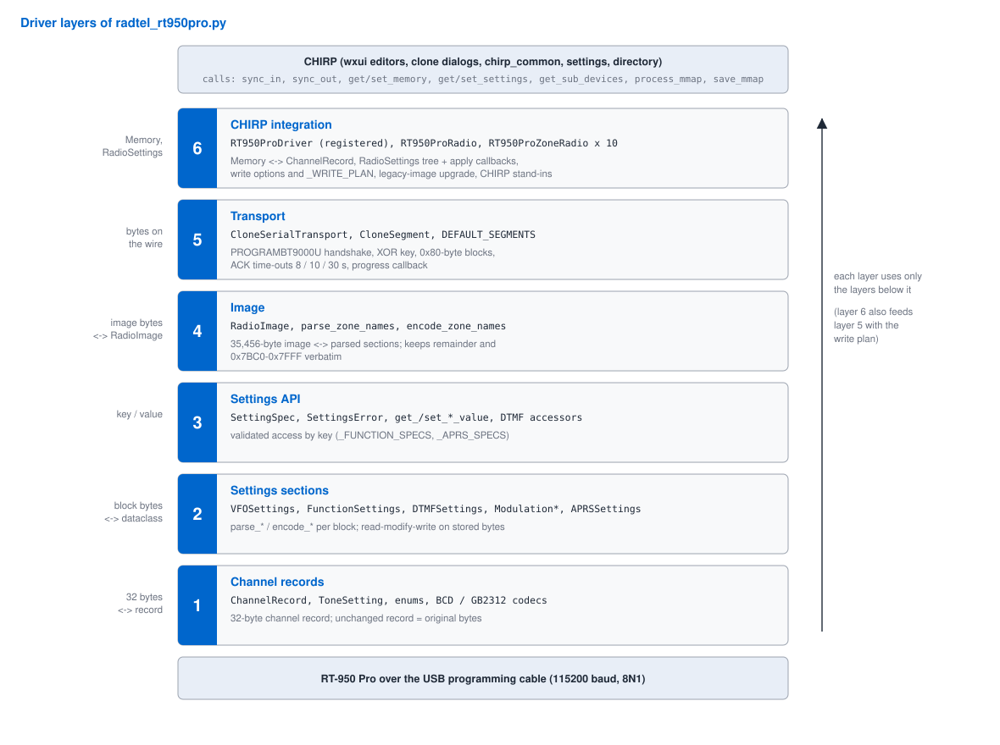
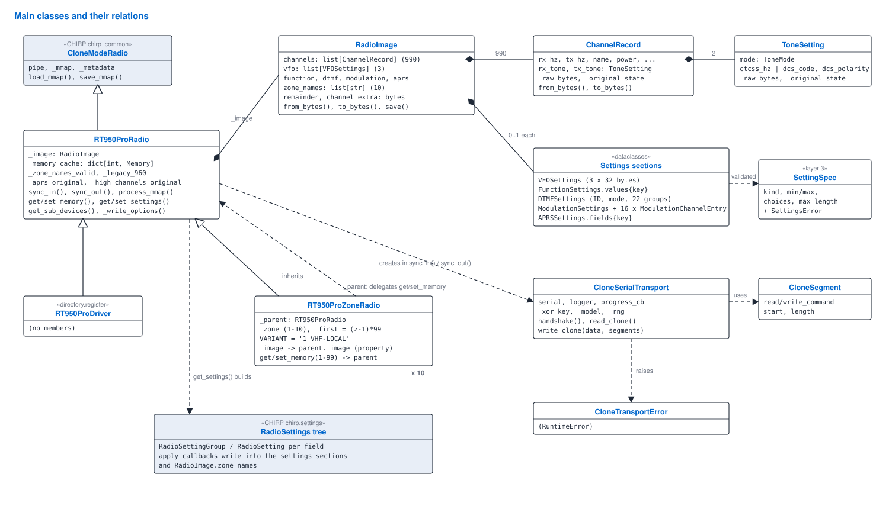
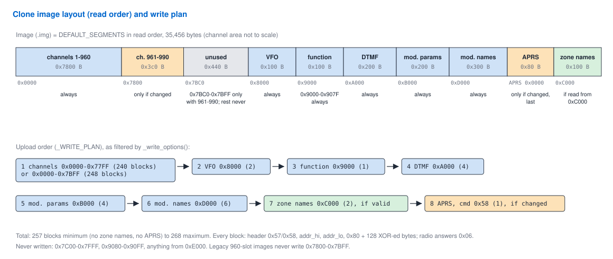

# Functional and technical design — `radtel_rt950pro.py`

Functional and technical design (FTO) of the CHIRP driver for the Radtel
RT-950 Pro. It describes what the program does (functional part) and how it
is built (technical part). The interaction with CHIRP, with sequence
diagrams, is in [`chirp-interface.md`](chirp-interface.md); byte-level
reference in [`memory-map.md`](memory-map.md) and
[`protocol.md`](protocol.md); every class and function is documented in the
[API documentation](https://pe1hvh.github.io/chirp_radtel_rt950pro).

| | |
|---|---|
| Program | `radtel_rt950pro.py` (single file, 6,957 lines) |
| Version | 0.1.7 (2026-10-24) |
| Radio | Radtel RT-950 Pro, firmware 0.24 and later (tested on 0.29) |
| Reference CPS | RT-950PRO_CPS v1.3.3 |
| Licence | MIT; © 2025 Nathan G. Barguss (2E0NBS), © 2026 PE1HVH |
| Status | Experimental |

---

## Part A — Functional design

### A1. Purpose

The driver lets CHIRP read, edit and write the memory of the RT-950 Pro over
its USB programming cable, as an alternative to the vendor CPS. Its main
point is full support for the radio's channel organisation since firmware
0.24: **10 zones of 99 channels (990 channels) with zone names**, each zone
shown as its own memory tab in CHIRP.

### A2. Users and context

* Radio amateurs who program the RT-950 Pro with CHIRP on Linux, macOS or
  Windows.
* The driver runs inside CHIRP; it has no user interface of its own. It is
  installed by loading it from CHIRP issue #12180 or by copying it into
  CHIRP's `drivers` directory (see README).

### A3. Functions

| ID | Function | Read | Write | Where |
|---|---|---|---|---|
| F-01 | Download the complete memory from the radio, with progress per block | ✅ | – | `sync_in` |
| F-02 | Upload the edited memory to the radio, with progress per block | – | ✅ | `sync_out` |
| F-03 | 990 channels shown as 10 zone tabs of 99 channels, tab titled with the zone name (Zone CH Mode) | ✅ | ✅ | `RT950ProZoneRadio` |
| F-04 | Channel fields: RX/TX frequency (simplex, ±offset, split when RX and TX are in different bands), name (12 bytes), CTCSS/DCS, power (3 levels), FM/NFM/AM, scan skip, scrambler, encryption | ✅ | ✅ | `_channel_to_memory`, `_apply_memory_to_channel` |
| F-05 | Zone names (10, max. 12 ASCII characters) | ✅ | ✅ | `_build_zone_group`, `encode_zone_names` |
| F-06 | VFO A/B/C settings | ✅ | ✅ | `_build_vfo_group` |
| F-07 | Function settings (27 shown, 57 known) | ✅ | ✅ | `_build_function_group` |
| F-08 | DTMF: own ID, PTT ID mode, code groups 1–5 (of 22) | ✅ | ✅ | `_build_dtmf_group` |
| F-09 | Broadcast/modulation settings and FM/AM/SSB memories | ✅ | ✅ | `_build_modulation_group` |
| F-10 | APRS settings (11 shown, 39 known), written with command `0x58` | ✅ | ✅ | `_build_aprs_group`, `DEFAULT_SEGMENTS` |
| F-11 | Save and open CHIRP `.img` files, including images of older driver versions | ✅ | ✅ | `process_mmap`, `save_mmap` |
| F-12 | Band rules: airband 118–137 MHz forced to AM, wide, TX disabled; 18–64 MHz forced to FM | – | ✅ | `_apply_memory_to_channel` |
| F-13 | Channel Divide (Zone CH Mode / All CH Mode): setting with the CPS labels; the view follows it (All CH Mode: one list 1–990, empty channels stay in place) and changes at once when the setting is changed | ✅ | ✅ | `_FUNCTION_UI`, `_all_channels_mode`, `get_features`, `get_sub_devices` |

### A4. Safety rules (functional)

The radio can be damaged or mis-programmed by a wrong write; these rules
limit what is written.

| ID | Rule |
|---|---|
| S-01 | Only data that was read from the radio is written back; unknown bytes are preserved. |
| S-02 | An unedited channel record or VFO entry is written back byte-identical. |
| S-03 | Channels 961–990 (`0x7800–0x7BFF`) are written only when one of them changed, and never for an image of the old 960-slot driver. |
| S-04 | `0x7C00–0x7FFF`, `0x9080–0x90FF` and anything from `0xE000` are never written. |
| S-05 | Zone names are written only when they were read from `0xC000` (image layout version 4 or later). |
| S-06 | The APRS block is written only when it changed, and as the last block. |
| S-07 | A record that cannot be encoded stops the upload before any byte is sent. |
| S-08 | A failed write names the command and address; a missing ACK on the APRS block gets its own message telling the user what was and was not saved. |

### A5. Out of scope

* Firmware with 960 channels (15 zones × 64): channels 961–990 are not
  written; the driver does not detect the firmware layout (open item).
* Settings added in CPS 1.3.x (offsets unknown).
* Function settings not in `_FUNCTION_UI`, APRS settings not in `_APRS_UI`,
  DTMF code groups 6–22: kept, not editable.
* Banks, live mode, radio detection.
* Calibration data.

---

## Part B — Technical design

### B1. Constraints

| Constraint | Consequence |
|---|---|
| CHIRP loads one Python file per driver | everything in `radtel_rt950pro.py`; structure by banner comments and layers |
| Must import without CHIRP (pydoc, `docs/build.py`) | `try: from chirp import …` with stand-in classes in the `except` branch; `HAVE_CHIRP` is then `False`; `get_features`, `get_settings`, `get_memory` and `set_memory` raise `RadioError` |
| Must import without pyserial | `serial = None`; `CloneSerialTransport.open()` then raises `CloneTransportError` |
| Python ≥ 3.10; CHIRP and pyserial at run time | otherwise standard library only (`dataclasses`, `enum`, `logging`, `random`, `time`, `typing`, `unicodedata`, `pathlib`); imports without CHIRP and pyserial |
| Code quality | pylint 10/10 (100 characters), pydocstyle Google convention, pydoclint; CHIRP itself uses 79 characters (reformat before a CHIRP PR) |
| Documentation | Google-style docstrings for every object, public and private; published by `docs/build.py` |

### B2. Architecture



The file is divided into six layers, from raw bytes up to CHIRP. Each layer
uses only the layers below it; layer 6 drives layer 5 (transport) and
layer 4 (image).

| Layer | Banner | Responsibility | Main objects |
|---|---|---|---|
| 1 | Channel records | 32-byte channel record and its codecs | `ToneSetting`, `ChannelRecord`, `ToneMode`, `PowerLevel`, `Bandwidth`, `Modulation`, `_encode/_decode_frequency`, `_encode/_decode_name`, FHSS codec |
| 2 | Settings sections | one dataclass and one `parse_*`/`encode_*` pair per settings block | `VFOSettings`, `FunctionSettings`, `DTMFSettings`, `ModulationSettings`, `ModulationChannelEntry`, `APRSSettings` |
| 3 | Settings API | validated access by key | `SettingSpec`, `SettingsError`, `get_/set_function_value`, `get_/set_aprs_value`, DTMF accessors |
| 4 | Image | complete clone image ↔ parsed structure | `RadioImage`, `parse_zone_names`, `encode_zone_names`, layout constants |
| 5 | Transport | serial clone protocol | `CloneSerialTransport`, `CloneSegment`, `CloneSerialConfig`, `CloneTransportError`, `DEFAULT_SEGMENTS` |
| 6 | CHIRP integration | CHIRP radio classes, memory and settings translation, write plan | `RT950ProRadio`, `RT950ProZoneRadio`, `RT950ProDriver`, `_WRITE_PLAN`, settings builders and apply callbacks, CHIRP stand-ins, `MEM_FORMAT` |

The public API is listed in `__all__` (53 names); everything with a leading
underscore is internal.



### B3. Design principles

1. **One source of truth.** All data lives in one `RadioImage`. CHIRP's
   memory map is parsed into it in `process_mmap()` and derived from it
   (`_build_clone_payload`) on save and upload.
2. **Change tracking instead of re-encoding.** `ToneSetting`,
   `ChannelRecord` and `VFOSettings` remember the bytes they were decoded
   from (`_raw_bytes`) and a tuple of their visible fields
   (`_original_state`). `to_bytes()` / `encode_vfo_section()` return the
   original bytes while the state is unchanged. After encoding, the new
   bytes become the reference.
3. **Read-modify-write for settings.** Section encoders start from the
   stored bytes (`RadioImage.remainder`) and replace only the bits of known
   fields. The modulation and APRS encoders write a field only when its
   value differs from what was read, so an unedited block stays
   byte-identical. One deviation is documented in the code: a field byte
   holding `0xFF` is treated as 0 before its bits are merged.
4. **Write less than you read.** The write plan is a filtered, re-ordered
   subset of the read layout (§B8).
5. **Fail before sending.** The complete payload is built before the serial
   session starts, so encoding errors never leave a half-written radio.

### B4. Data model

#### B4.1 Clone image



The image is the concatenation of `DEFAULT_SEGMENTS` in read order, 35,456
bytes (`_SEGMENT_LENGTH`):

| Image offset | Length | Radio address | Content | Parsed into |
|---|---|---|---|---|
| `0x0000` | `0x7BC0` | `0x0000` | 990 × 32-byte channel records | `channels` |
| `0x7BC0` | `0x440` | `0x7BC0` | unused | `channel_extra` (verbatim) |
| `0x8000` | `0x100` | `0x8000` | VFO A/B/C (96 bytes used) | `vfo` |
| `0x8100` | `0x100` | `0x9000` | function settings (96 used) | `function` |
| `0x8200` | `0x200` | `0xA000` | DTMF (384 used) | `dtmf` |
| `0x8400` | `0x200` | `0xB000` | modulation parameters (256 used) | `modulation` |
| `0x8600` | `0x300` | `0xD000` | modulation names | `modulation` |
| `0x8900` | `0x80` | APRS `0x0000` | APRS block | `aprs` |
| `0x8980` | `0x100` | `0xC000` | zone names, 10 × 16 bytes | `zone_names` |

Image offsets differ from radio addresses from `0x8100` on: the image is
packed, the radio address space is not.

`RadioImage.remainder` holds all bytes from image offset `0x8000` as read;
encoders use it as the base, so bytes the driver does not understand
survive.

#### B4.2 Channel record (32 bytes)

| Offset | Field | Encoding |
|---|---|---|
| 0–3 | RX frequency | packed BCD, 10 Hz units, least significant byte first; all `0x00`/`0xFF` = empty slot |
| 4–7 | TX frequency | same |
| 8–9 | RX tone | `00 00` / `FF FF` off; `nn 00` DCS index 1–210 into `_DCS_CODES`; otherwise CTCSS in 0.1 Hz, little-endian |
| 10–11 | TX tone | same |
| 12 | signalling group | low nibble |
| 13 | PTT ID | low nibble |
| 14 | scrambler / power | high nibble / low nibble (0 high, 1 medium, 2 low) |
| 15 | flags | b7 learn FHSS, b6 narrow, b5–4 encryption, b3 busy lockout, b2 scan add, b1 TX enable, b0 AM |
| 16–19 | FHSS code | byte 19 = `0xA0` when set; bytes 18, 17, 16 = six hex digits |
| 20–31 | name | GB2312, padded with `0xFF` |

`_DCS_CODES` has 210 entries: index 1–105 normal (`N`), 106–210 inverted
(`I`).

Name encoding (`_encode_name`): if the name is not GB2312-encodable it is
NFKD-normalised and reduced to ASCII; characters that still cannot be
encoded are dropped; the result is cut to 12 bytes without splitting a
character. Every alteration is logged.

#### B4.3 Settings sections

| Section | Dataclass | Storage | Notes |
|---|---|---|---|
| VFO | `VFOSettings` × 3 | typed fields, change tracking | frequency 8 digits (10 Hz), offset 7 digits (100 Hz), one decimal digit per byte |
| Function | `FunctionSettings.values` | `dict[key → int or None]` | 57 keys in `_FUNCTION_SPECS`; mostly low nibble per byte; byte 26 packs `work_mode_a/b/c` |
| DTMF | `DTMFSettings` | ID (5), PTT ID mode, two timing values, 22 code groups (6 symbols) | symbols `0-9 A-D * #`, `0xFF` terminates |
| Modulation | `ModulationSettings` + 16 × `ModulationChannelEntry` | global values + FM/AM/SSB memories | frequencies in 10 kHz units; names in a separate block |
| APRS | `APRSSettings.fields` | `dict[key → int, str or None]` | 39 keys in `_APRS_SPECS`; lat/lon as letter + minute/degree/second; altitude signed 16-bit; custom message at offset 79, 40 bytes |
| Zone names | `RadioImage.zone_names` | `list[str]` × 10 | read up to 16 bytes; an edited name is written max. 12, an unedited one as read; padding byte of the slot kept |

`None` in a section means "byte was `0xFF` (not set)".

### B5. Layer 1 — channel records

* `ChannelRecord.from_bytes()` decodes all fields and stores `_raw_bytes`
  and `_original_state`. A power nibble above 2 decodes as LOW.
* `ChannelRecord.to_bytes()` returns `_raw_bytes` when the state is
  unchanged. Otherwise it rebuilds the record from `0xFF`: known fields
  only, bytes 12 and 13 keep their high nibble (0 when the old byte was
  `0xFF`), the FHSS field is
  `0xFF × 4` without a code, the name is padded with `0xFF`. The new bytes
  become the reference.
* `ToneSetting` follows the same pattern for its two bytes, so an unknown
  DCS index (decoded as OFF and logged) is written back unchanged unless the
  tone is edited.
* Errors (`ValueError`): record not 32 bytes, non-BCD nibble, frequency not
  a multiple of 10 Hz or above 8 digits, unknown DCS code, CTCSS out of
  0.1–6553.5 Hz, FHSS code not 6 hex digits.

### B6. Layers 2 and 3 — settings

**Parsing** (`parse_*_section`) takes the used part of a block and returns
its dataclass; length errors raise `ValueError`.

**Encoding** (`encode_*_section(settings, raw)`) starts from `raw` (or
`0xFF` when `raw` has the wrong length), returns `raw` unchanged when
`settings` is `None`, and otherwise writes only known bits:

| Encoder | Specific behaviour |
|---|---|
| `encode_vfo_section` | unchanged entries copied verbatim; `rx_hz`/`offset_hz` `None` keep the stored digits; entries beyond the third ignored |
| `encode_function_section` | value `None` or missing key writes `0xFF` over the whole byte; byte 26 becomes `0xFF` if any work mode is `None` |
| `encode_dtmf_section` | own ID and code groups rewritten only when their text changed (a rewritten group gets `0xFF` in bytes 6–15); info bytes 6–8 always written to the low nibble |
| `encode_modulation_sections` | each field compared with the value parsed from the stored blocks and written only when it differs; a global field that is `None` (not set) is never written; names only when the text changed; entries beyond `len(channels)` cleared to `0xFF` |
| `encode_aprs_section` | each field and text compared with the value parsed from the stored block and written only when it differs, so unusual stored bytes (hemisphere letters, position digits, altitude, icon) are kept |
| `encode_zone_names` | unchanged names byte-identical; changed name cut to 12 ASCII characters, padded with the slot's own padding byte (`0x00` or `0xFF`) |

**Settings API** (layer 3). `SettingSpec(kind, min_value, max_value,
choices, max_length)` describes one setting; `_validate()` enforces it
(`bool` accepts `True/False/0/1`, `int` a range, `enum` a set of values;
strings are checked in `set_aprs_value`). Violations raise `SettingsError`
(a `ValueError`); an unknown key raises `KeyError`. `None` marks a setting
as not set. DTMF has dedicated accessors that check the symbol set and
maximum length.

### B7. Layer 4 — image

`RadioImage.from_bytes(blob)`:

1. Rejects data shorter than `0x8000`.
2. Decodes 990 channel records from `0x0000–0x7BBF`.
3. Parses each following section only if the blob is long enough for it;
   otherwise that section stays `None`.
4. Stores `remainder = blob[0x8000:]` and
   `channel_extra = blob[0x7BC0:0x8000]`.

`RadioImage.to_bytes()`:

1. Requires exactly 990 channels.
2. Pads `remainder` with `0xFF` to the known length (`KNOWN_SEGMENT_BYTES`).
3. Re-encodes each section in place within that tail (VFO, function, DTMF,
   modulation, APRS, zone names).
4. Builds the channel segment: `channel_extra` verbatim, then every
   channel's `to_bytes()`.
5. Returns channel segment + tail. Side effect: change-tracking snapshots of
   edited channels and VFO entries are updated.

`_build_clone_payload(image)` (layer 6) calls `to_bytes()` and checks the
result is exactly `_SEGMENT_LENGTH` bytes.

### B8. Layer 5 — transport

`CloneSerialTransport` wraps an open port (CHIRP's pipe) or opens one with
`open(CloneSerialConfig)`.

| Step | Bytes | Answer | Failure |
|---|---|---|---|
| Enter clone mode | `PROGRAMBT9000U` | `0x06` | `Handshake ACK not received` |
| Identify | `F` | 16 bytes (logged) | time-out |
| Model | `M` | 12 bytes ASCII | `Radio did not return a model identifier` |
| Key | 25-byte `SEND` frame | `0x06` | `Encryption ACK not received` |
| Read block | `cmd, hi, lo, 0x80` | 4 + 128 bytes | `Serial read timed out` |
| Write block | `cmd, hi, lo, 0x80` + 128 bytes | `0x06` | `No ACK for write cmd … address …`, `Write ACK mismatch at …` |
| End | `E` | – | – |

**Key selection** (`_build_encryption_frame`): bytes 0–3 `SEND`; byte 4 a
random code `0x10–0x14` or `0x20–0x24`; bytes 5–23 random indexes 0–19;
byte 24 `0x00`. Code `0x1n` selects `frame[5 + 2n]`, code `0x2n` selects
`frame[6 + 2n]`; that byte indexes `ENCRYPT_STRINGS` (20 four-byte keys).
The random source can be injected (`rng`) for reproducible tests.

**XOR** (`_apply_xor`): byte *i* uses key byte *i mod 4*; a byte stays
unchanged if it is `0x00` or `0xFF`, equals the key byte or its complement,
or if the key byte is `0x20`.

**Timing**: port time-outs are raised to at least 3 s. During a write the
time-out for the ACK is set per block (8 s channels, 10 s from `0x8000`,
30 s APRS) and restored after a successful ACK (a failure leaves before the
restore); pauses of 0.05 s (from `0x8000`) and
0.1 s + 0.5 s (APRS) follow the ACK. Values follow NeonPlug's RT-950 Pro
pacing.

**Progress**: optional `progress_cb(done, total, phase)` after every block;
exceptions in the callback are swallowed so progress can never break a
clone.

### B9. Layer 6 — CHIRP integration

#### B9.1 Classes

| Class | Base | Purpose |
|---|---|---|
| `RT950ProRadio` | `chirp_common.CloneModeRadio` | all behaviour; memories 1–990 |
| `RT950ProDriver` | `RT950ProRadio` | the registered class (`@directory.register`); empty |
| `RT950ProZoneRadio` | `RT950ProRadio` | one zone as a sub-device (Zone CH Mode only); maps 1–99 to the parent; no own data, does not call CHIRP's constructor |

#### B9.2 State of `RT950ProRadio`

| Attribute | Set in | Meaning |
|---|---|---|
| `_image` | `process_mmap` | the parsed `RadioImage`, or `None` |
| `_memory_cache` | `get_memory`, `set_memory`; cleared in `process_mmap`, `set_settings` | `Memory` objects by number 1–990, shared with the zones |
| `_memobj` | `_parse_memobj` | `bitwise` view for the developer Browser tab only |
| `_zone_names_valid` | `process_mmap` | image size complete and `rt950_layout ≥ 4` → zone names may be written |
| `_legacy_960` | `process_mmap` | image of the old 960-slot driver → never write `0x7800–0x7BFF` |
| `_aprs_original` | `process_mmap` | APRS block at load time; `None` disables the APRS write |
| `_high_channels_original` | `process_mmap` | bytes `0x7800–0x7BFF` at load time; `None` disables writing them |
| `_metadata` | CHIRP, `sync_in` | image metadata; `sync_in` sets `{'rt950_layout': 4}` |

`__init__` sets all of these before calling CHIRP's constructor, because
that constructor may already call `process_mmap()`.

#### B9.3 Image versions

`_LAYOUT_VERSION = 4` is stored in the `.img` metadata as `rt950_layout`.
`process_mmap()` recognises: complete images (35,456 bytes) with or without
a valid layout version, images without the zone-name segment (35,200), and
images of the old 960-slot driver (33,152). Older images are padded with
`0xFF` so all offsets line up; their zone names are never written, and
legacy images never write channels 961–990 (table in
[`chirp-interface.md` §6](chirp-interface.md#6-opening-an-img-file-process_mmap)).

#### B9.4 Memory translation

`_channel_to_memory`, `_apply_offset`, `_apply_tones` (radio → CHIRP) and
`_apply_memory_to_channel`, `_update_tones_from_memory` (CHIRP → radio).
Field and tone mapping tables are in
[`chirp-interface.md` §8](chirp-interface.md#8-memory--channel-record-mapping).
Extra per-memory settings (`scrambler`, `encryption`) travel in
`Memory.extra` as a `RadioSettingGroup` (`_build_memory_extra`,
`_extract_memory_extra`, which accepts a dict as well).

#### B9.5 Settings UI

The UI tables `_FUNCTION_UI` (27 keys) and `_APRS_UI` (11 keys) map a key
to label, type (`bool`, `int`, `enum`, `string`) and range or choices. A
`_FUNCTION_UI` entry with `'volatile': True` (only Channel Divide) is marked
volatile by `_create_function_setting`, so CHIRP rebuilds the editor after
it is changed ([`chirp-interface.md` §7.4](chirp-interface.md#74-channel-divide-zone-tabs-or-one-list)).
`_build_setting_value()` turns an entry into the matching CHIRP value object;
`_create_function_setting` / `_create_aprs_setting` attach
`_apply_function_setting` / `_apply_aprs_setting` as callback. VFO,
modulation, DTMF and zone names have hand-written builders: VFO lists use
one shared builder and callback (`_make_list_setting`, `_apply_list_choice`,
which leaves a value outside the list unchanged), tones `_apply_vfo_tone`,
frequencies `_apply_vfo_frequency` (which also sets Freq Band: UHF from
300 MHz) and `_apply_vfo_offset`; Freq Band is read-only without callback;
modulation uses `_apply_modulation_int` for the three current channels
(0–14) and the same list builder for work mode, modulation mode, AM/SSB step
and AM/SSB Rx Gain, with the CPS labels; DTMF has one per kind (ID, mode, group), zone names one
(`_apply_zone_name`). Value readers `_value_as_bool`,
`_value_as_int`, `_value_as_index` (index or label lookup) and
`_value_as_string` hide the difference between CHIRP's value objects and
plain values.

#### B9.6 Write plan

`_WRITE_PLAN` lists `(index into DEFAULT_SEGMENTS, length)` in write order:
channels (`0x7C00`), VFO, function (`0x80`: only `0x9000–0x907F`; the
meaning of `0x9080–0x90FF` is unknown and the radio changes it), DTMF,
modulation parameters, modulation names, zone names, APRS. `_write_options()` decides three switches;
`_build_write_plan(payload, write_zone_names, channel_bytes, write_aprs)`
applies them:

| Condition | Channels written | Zone names | APRS | Blocks |
|---|---|---|---|---|
| nothing optional | `0x0000–0x77FF` | no | no | 257 |
| typical (fresh download, no APRS edit) | `0x0000–0x77FF` | yes | no | 259 |
| ch. 961–990 edited, APRS edited | `0x0000–0x7BFF` | yes | yes (`0x58`, last) | 268 |

#### B9.7 Error mapping

| Origin | Mapped to |
|---|---|
| any exception in `read_clone` | `RadioError('Clone read failed: …')` |
| `CloneTransportError` with `cmd 0x58` | `RadioError` with the APRS explanation |
| any other exception in the write | `RadioError('Clone write failed: …')` |
| `ValueError` in `RadioImage.from_bytes` | `RadioError('Failed to parse memory map: …')` |
| exceptions in an apply callback | `RadioError(message)` for function and APRS (all four kinds), partly for DTMF and VFO; modulation-memory frequency raises a plain `ValueError` (table in [chirp-interface §10](chirp-interface.md#10-settings)) |
| memory number out of range, no image, no port | `RadioError` |

Errors are swallowed (broad `except Exception`) only where a failure must
not stop the main operation: progress reporting and `Status` creation, the
Browser view, the snapshots in `process_mmap`, adjusting port time-outs,
closing the port, and the fallbacks of `_value_as_int` / `_value_as_index`.
Each place is commented in the code.

### B10. Processing flows

| Flow | Steps | Diagram |
|---|---|---|
| Load driver | import → register `RT950ProDriver` | [chirp-interface §3](chirp-interface.md#3-loading-the-driver) |
| Download | transport handshake → 277 blocks → `_metadata` → `process_mmap` | [§4](chirp-interface.md#4-download-from-the-radio), [§5](chirp-interface.md#5-clone-session-on-the-wire) |
| Open `.img` | metadata match → `load_mmap` → `process_mmap` (upgrade) | [§6](chirp-interface.md#6-opening-an-img-file-process_mmap) |
| Show memories | zone → parent → cache or `_channel_to_memory` | [§7](chirp-interface.md#7-the-editor-zones-as-sub-devices) |
| Edit memory | zone copy → parent → `_apply_memory_to_channel` → cache | [§9](chirp-interface.md#9-editing-and-deleting-a-memory) |
| Settings | builders → callbacks → sections | [§10](chirp-interface.md#10-settings) |
| Save | `to_bytes` → `MemoryMapBytes` → CHIRP writes file + metadata | [§11](chirp-interface.md#11-saving-an-img-file) |
| Upload | payload → options → plan → handshake → blocks → `E` | [§12](chirp-interface.md#12-upload-to-the-radio) |

### B11. Logging

| Logger | Name | Content |
|---|---|---|
| `LOG` | module name | driver warnings (old images, parse problems, unknown DCS index), diagnostic text in `0x7BC0–0x7FFF`, and the protocol trace of `sync_in`/`sync_out` (debug) |
| `CHANNEL_LOG` | module name + `.image` | decoding and encoding warnings of `RadioImage` (invalid GB2312, altered or truncated names) |
| transport default | module name + `.transport` | protocol trace when a transport is created without a logger |

`LOG` is first defined in layer 1 (`.channel`) and rebound in layer 6;
functions look it up at call time, so all direct `LOG` use goes to the
final driver logger.

### B12. Testing

Tests run against a CHIRP source tree:

```
git clone https://github.com/kk7ds/chirp ~/src/chirp
CHIRP_SRC=~/src/chirp python3 -m pytest tests
```

`tests/sample.py` builds a neutral two-zone image (`VHF-LOCAL`,
`UHF-LOCAL`, eight invented channels) and loads it as if freshly read.

| Test | Checks |
|---|---|
| `test_layout_constants` | 990 channels, `0x7BC0`, `0xC000`, APRS write command `0x58` |
| `test_zone_mapping` | 10 sub-devices, zone/channel → memory mapping |
| `test_zone_names_and_labels` | zone names and tab labels |
| `test_untouched_roundtrip_is_byte_identical` | S-01 / S-02 |
| `test_aprs_message_nul_padding` | custom message NUL padding kept |
| `test_set_memory_does_not_modify_frozen_input` | zone path does not modify CHIRP's memory |
| `test_zone_name_via_settings` | zone name edit reaches the saved image |
| `test_edits_reach_saved_image` | memory edit reaches the saved image |
| `test_plan_unchanged_skips_aprs_and_high_channels` | S-03 / S-06 without edits |
| `test_plan_writes_high_channels_only_when_changed` | S-03 |
| `test_plan_writes_aprs_last_with_0x58_when_changed` | S-06 |
| `test_old_images_never_write_zone_names` | S-05 |
| `test_legacy_960_image_never_writes_past_0x7800` | S-03 for legacy images |
| `test_write_error_names_command_and_address` | S-08, transport message only (the dedicated APRS `RadioError` in `sync_out` is not tested) |

`tests/test_radio_values.py` pins down values measured on a radio with the
CPS (encodings from the radio, frequencies invented):

| Test | Checks |
|---|---|
| `test_vfo_power_decodes_all_three_levels` | VFO power 0/1/2 decodes as High/Middle/Low |
| `test_settings_apply_without_edit_keeps_vfo_bytes` | a settings apply without an edit leaves the VFO bytes unchanged (S-02) |
| `test_vfo_screen_follows_cps_labels_and_order` | VFO-A to VFO-C with the CPS fields in CPS order |
| `test_vfo_screen_shows_measured_values` | every VFO field shows what the CPS showed for the same bytes |
| `test_vfo_choice_lists_match_cps` | Step Freq, Tx Power, Scramble, Signalling, Offset Dir, Encryption and tone lists |
| `test_vfo_freq_band_is_read_only` | Freq Band read-only, no callback |
| `test_vfo_edit_writes_cps_encoding` | edited step, power, signalling and tone stored as the CPS stores them |
| `test_vfo_value_outside_list_is_left_alone` | a value the CPS does not offer is shown as unknown and kept |
| `test_channel_encryption_3_is_kept` | channel encryption 3 and scramble 8 |
| `test_side_key_ranges_match_cps` | PF1 0-7, PF2 0-6 |
| `test_aprs_ranges_match_cps` | Timed Beacon Time 0-9, Radio Symbol 0-4 |
| `test_zone_name_of_twelve_characters_loads_and_saves` | 12-character zone names |
| `test_zone_name_longer_than_twelve_is_shown_and_kept` | a longer name written by other software loads and is kept |
| `test_vfo_group_builds_with_the_stand_in_classes` | the VFO group also builds without CHIRP |
| `test_vfo_band_follows_rx_freq` | Freq Band becomes VHF below and UHF from 300 MHz when Rx Freq is edited |
| `test_modulation_screen_uses_cps_lists` | modulation labels and lists as in the CPS |
| `test_modulation_edit_and_unset_value` | an edited modulation list is stored; a value that is not set is shown as such and kept |
| `test_modulation_current_channel_range_matches_decoding` | current channels 0–14 |

`tests/test_known_issues.py` covers the known issues 2–4, 7, 8 and 10 of
[`status.md`](status.md) (1, 6 and 9 are in `test_radio_values.py`) and three
smaller fixes of 0.1.5 (GB2312 cut, DTMF index, function segment):

| Test | Checks |
|---|---|
| `test_inverted_dcs_reads_as_chirp_reverse_polarity` | radio `I` → CHIRP `R` |
| `test_chirp_reverse_polarity_is_written_as_inverted` | CHIRP `R` → radio `I` |
| `test_mixed_tones_are_shown_as_cross_and_written_back` | RX-only and mixed tones as CHIRP `Cross`, written back unchanged (seven cross modes) |
| `test_features_offer_cross_modes` | `Cross` and CHIRP's cross modes in the features |
| `test_set_memory_does_not_change_the_callers_memory` | `set_memory` leaves CHIRP's memory unchanged |
| `test_edited_channel_keeps_high_nibbles_of_bytes_12_and_13` | unused nibbles of an edited channel record kept |
| `test_settings_apply_writes_only_the_changed_setting` | an apply runs only the callback of the changed setting |
| `test_unset_modulation_block_is_written_back_unchanged` | an all-`0xFF` modulation block stays `0xFF` |
| `test_modulation_bandwidth_zero_is_kept` | SSB bandwidth 0 kept |
| `test_unusual_aprs_bytes_are_written_back_unchanged` | unusual stored APRS bytes kept |
| `test_gb2312_text_is_not_cut_inside_a_character` | a GB2312 name is cut between characters |
| `test_negative_dtmf_code_group_index_is_refused` | DTMF code group index below 0 refused |
| `test_function_segment_write_stops_before_0x9080` | function segment written as one block (S-04) |

`tests/test_ident_dump.py` checks `tools/ident_dump.py` against a simulated
radio with invented answers:

| Test | Checks |
|---|---|
| `test_identify_records_all_answers_and_ends_session` | all four answers recorded; only the handshake string, `F`, `M`, the `SEND` frame and `E` are sent (5 writes); port closed |
| `test_find_version_reports_answer_and_offset` | an ASCII version is found with answer number and offset |
| `test_find_version_bcd_and_binary` | BCD and binary forms are found |
| `test_version_patterns_rejects_bad_input` | a version that is not `<major>.<minor>` is refused |
| `test_main_prints_answers` | hex/ASCII output and search result on the command line |
| `test_empty_expect_is_refused` | an empty `--expect` stops with exit code 2 |
| `test_version_patterns_rejects_non_ascii_digits` | non-ASCII digits are refused |

`tests/test_cleanup.py` covers the clean-up of 0.1.6:

| Test | Checks |
|---|---|
| `test_duplex_follows_the_bands` | simplex, `-` 600 kHz, `+` 7.6 MHz within one band; RX 145.5 / TX 435.0 MHz is `split` |
| `test_split_channel_round_trips` | a split channel entered in CHIRP (RX and TX in different bands) is written with TX = offset and read back as split |
| `test_unused_tone_info_class_is_gone` | `_ToneInfo` removed |
| `test_without_chirp_the_driver_says_chirp_is_required` | with CHIRP blocked (subprocess) `HAVE_CHIRP` is `False` and `get_features`, `get_settings`, `get_memory`, `set_memory` raise `RadioError` naming CHIRP |
| `test_with_chirp_the_flag_is_set` | `HAVE_CHIRP` is `True` with CHIRP |
| `test_find_zone_names_usage_has_a_single_backslash` | the usage text of `find_zone_names.py` continues the shell line |

`tests/test_channel_divide.py` covers Channel Divide (values measured on a
radio: byte `0x9026`, 0 Zone CH Mode, 1 All CH Mode):

| Test | Checks |
|---|---|
| `test_measured_values` | constants 0 and 1, offset `0x9026` |
| `test_setting_follows_cps_label_and_list` | label *Channel Divide*, CPS choices in CPS order, volatile |
| `test_stored_value_is_shown` | 0 and 1 are shown as the matching choice |
| `test_zone_mode_shows_ten_zone_tabs` | Zone CH Mode: ten sub-devices of 99, `has_dynamic_subdevices` |
| `test_all_mode_shows_one_list_of_990` | All CH Mode: no sub-devices, bounds 1–990 |
| `test_all_mode_numbering_keeps_empty_channels` | channel *n* is slot *n*; empty channels stay in place |
| `test_unset_value_shows_zones_and_is_kept` | `0xFF` shows the zones and is kept without an edit |
| `test_changing_the_setting_switches_view_and_one_byte` | an edit in both directions changes only `0x9026` and switches the view without a reload |
| `test_all_mode_edit_writes_the_same_slot` | a memory edited in the single list lands in the same zone slot |

`tests/test_check_docstrings.py` checks `tools/check_docstrings.py` and the
repository itself:

| Test | Checks |
|---|---|
| `test_reports_public_private_nested_and_stand_in_objects` | public, private, nested and `except`-block functions without a docstring are reported |
| `test_reports_missing_module_docstring` | a module without a docstring is reported |
| `test_main_exit_status` | exit status 1 with a report line, 0 when complete |
| `test_repository_is_fully_documented` | the driver, `tools/*.py` and `docs/build.py` pass |
| `test_unreadable_file_is_reported_not_raised` | a file that is not UTF-8 is reported, not a traceback |

Tools: `tools/make_sample_image.py` (sample `.img`),
`tools/find_zone_names.py` (read-only scan of unread address ranges; found
`0xC000`), `tools/raw_dump.py` (read-only dump of the clone image,
XOR-decoded, without the driver's encoders), `tools/ident_dump.py`
(read-only: every byte of the handshake answers, with a search for the
firmware version), `tools/check_docstrings.py` (every object has a
docstring), `tools/chirp_list_left.py`
(optional CHIRP patch).

### B13. Documentation build

`docs/build.py` builds one page, `radtel_rt950pro.html`:

1. **Documents.** `fto.md` and `chirp-interface.md` (list `DOCUMENTS`) are
   converted from Markdown with pdoc's markdown2 settings and placed above
   the API reference, with a *Documents* group in the side menu. Headings
   get the anchor GitHub would give them, prefixed per document (`design-`,
   `interface-`), so the same links work on GitHub and on the page. Links to
   other Markdown files go to GitHub for the branch being built; names in
   code font are linked to the API by pdoc's `linkify`; diagrams are copied
   next to the page and open full size on click. A link between documents
   to a missing anchor stops the build. Each layer heading of the API links
   back to its design chapter (B5–B9).
2. **API reference.** pdoc renders the module, grouped by the layer and
   section banners in the source; private objects are included (closed
   lock) next to public ones (open lock).

The GitHub Action `.github/workflows/docs.yml` checks the driver's
docstrings with pydocstyle, pylint and pydoclint, then builds `main` into the
site root and `develop` into `/develop/` and publishes both to GitHub Pages on
every push to either branch. The checks cover the driver, `docs/build.py`
and `tools/*.py`. pydocstyle only checks public names (in a module with
`__all__`: the names in it); pylint's
missing-docstring checks (with no exemption for names starting with `_`)
cover every other module-level class, function and method; neither looks
at nested functions. `tools/check_docstrings.py` closes that gap: it walks
the syntax tree and reports every module, class and function without a
docstring, nested functions and the CHIRP stand-ins in the `except` branch
included. The Action runs it only in a checkout that contains it (0.1.6 and
later), so an older `main` still builds.

**Diagrams.** The SVG files in `docs/diagrams` are generated, not drawn by
hand:

| Script | Writes |
|---|---|
| `tools/make_diagrams.py` | the sequence diagrams `seq-01` to `seq-09`, one function per diagram, rendered with `tools/seqsvg.py` |
| `tools/make_fto_diagrams.py` | the structure diagrams `fto-layers`, `fto-classes` and `fto-write-plan` |

After changing a diagram, run both from the repository root and check the
result in a browser (text widths are estimated, positions are fixed):

```
python3 tools/make_diagrams.py
python3 tools/make_fto_diagrams.py
```

Both write to `docs/diagrams` by default, or to the directory given as the
first argument. Only the standard library is needed.

### B14. Known issues and observations

Known issues are listed in [`status.md`](status.md); they are not repeated
here. Still open: a VFO tone with a DCS index the driver does not know,
which is shown as OFF (choosing OFF then does not clear it). Known issues
1–4 and 6–10 are fixed in 0.1.5, each with a test; the unused `_ToneInfo`
(5) is removed in 0.1.6.

Additional observations from the interface analysis (snapshots not refreshed
after an upload, comments lost after a zone rename, progress text past
channel 990, repeated payload builds, comments that differ per Channel
Divide view) are in
[`chirp-interface.md` §15](chirp-interface.md#15-observations-from-this-analysis).

### B15. Open items

From [`status.md`](status.md):

* a VFO tone with a DCS index the driver does not know is shown as OFF;
* find out what `0x9080–0x90FF` is;
* detect the firmware layout (960 vs 990 channels) before writing;
* compare the handshake with CHIRP's RT-920 driver;
* await the maintainers' response to the proposal in #12180.

The route to official CHIRP support (subclass of the RT-920 driver, GPLv3,
test image) is described separately in `status.md`.

---

## Glossary

| Term | Meaning |
|---|---|
| ACK | `0x06`, the radio's acknowledgement of a command or block |
| Block | 0x80 (128) bytes, the unit of every read and write |
| Clone image / `.img` | the complete memory as CHIRP stores it, plus CHIRP metadata |
| CPS | the vendor's programming software (RT-950PRO_CPS) |
| Payload | the 35,456 image bytes in `DEFAULT_SEGMENTS` order |
| Segment | a contiguous address range with its read and write command (`CloneSegment`) |
| Slot | 0-based channel position 0–989 in `RadioImage.channels` |
| Sub-device | a CHIRP radio object that shows part of a radio as its own tab (here: a zone) |
| `VARIANT` | CHIRP's variant name; for a zone the tab suffix, e.g. `1 VHF-LOCAL` |
| Write plan | the ordered, filtered list of segments sent on upload |
| XOR key | one of 20 four-byte strings selected during the handshake |
